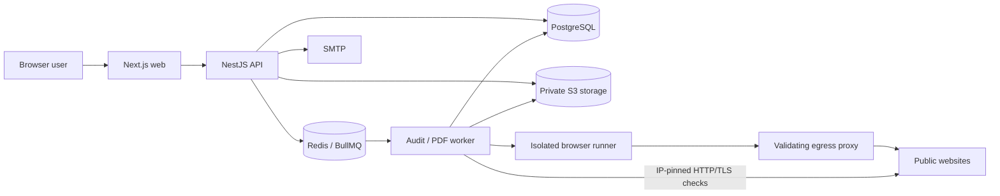

# Architecture

The API returns 202 after persisting an audit, usage event and outbox entry in one transaction. It dispatches outbox events into Redis and periodically reconciles queue and database state. A per-user database advisory lock makes quotas and one-active-audit enforcement atomic across API instances. Job IDs equal database IDs.

The worker uses a Redis hostname lease, bounded requests, robots policy, crawler limits, and separate module results. The browser runner is a different process/container with no application secrets. It connects to external sites through a proxy that rejects nonpublic addresses and pins each socket to a validated DNS answer. Browser networks are internal Docker networks; the proxy has a separate outbound network. Browser interception supplements this boundary rather than replacing it.

Results and raw measurements are stored in PostgreSQL; PNG/PDF bytes are private S3 objects. Authorized API handlers serve them after checking the owner. Dates are UTC; daily quotas reset at 00:00 UTC. SSE reports persisted stage changes; reloading a page reloads actual state.

Performance scores are Lighthouse lab measurements per device. Other modules use score=null where no supported score exists. CrUX is opt-in and can be unavailable. Accessibility checks cover automated rules only; HTTP/TLS checks are not penetration testing. PDF rendering disables JavaScript and outgoing requests and escapes inspected content.

## Development agents

| Role | Paths | Deliverable |
|---|---|---|
| Frontend | apps/web | Responsive interface, forms, reports, comparisons, SSE |
| Backend | apps/api | Auth, sessions, API, owner checks, quotas, queue dispatch |
| Audit Engine | apps/worker, apps/browser | Real measurements, bounded analysis, PDF |
| Coordinator / DevOps | packages/core, prisma, infra, compose.yaml | Contracts, isolation, storage, deployment |
| QA / Security | tests, review | Functional and adversarial verification |

These are development responsibilities documented in AGENTS.md. Running the app does not require an AI key and does not start an AI coding agent. Future AI interpretation would be a separate feature after the audit engine is stable.
